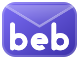
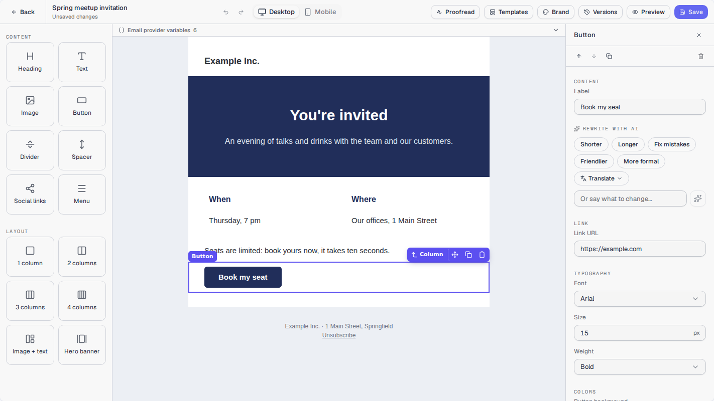

<p align="center">
  
</p>

<h1 align="center">Best Email Builder</h1>

<p align="center">
  A drag-and-drop email builder for React.<br>
  Emails that render in Outlook, Gmail, Apple Mail and on phones. Your server, your database, MIT-licensed.
</p>

<p align="center">
  <a href="https://www.npmjs.com/package/best-email-builder"></a>
  <a href="https://www.npmjs.com/package/best-email-builder"></a>
  <a href="https://github.com/SergeMiro/best-email-builder/actions/workflows/ci.yml"></a>
  <a href="LICENSE"></a>
</p>

<p align="center">
  <a href="https://sergemiro.github.io/best-email-builder/"><b>Live demo</b></a>
  &nbsp;·&nbsp;
  <a href="docs/README.md"><b>Documentation</b></a>
  &nbsp;·&nbsp;
  <a href="https://www.npmjs.com/package/best-email-builder"><b>npm</b></a>
</p>

<p align="center">
  <a href="https://sergemiro.github.io/best-email-builder/"></a>
</p>

## Why

Every product that talks to its users ends up needing an email editor. The
usual choice is a paid widget you cannot own, or a canvas you wire to MJML,
storage, validation and sending yourself. This is the second option, done
once and given away.

- **Free and yours.** MIT, no account, no vendor. A React component and a
  server handler that run in your app, against your database.
- **Emails that hold up.** Every block compiles through MJML to table-based
  HTML, checked against what Outlook, Gmail and Apple Mail need.
- **The server compiles.** The browser never sends HTML. The server validates
  the template, compiles it and stores its own HTML.
- **Only what you use.** The library, the editor and the AI are separate
  entry points, and one never pulls in the other's code.

## Features

**Editor**
- Content blocks (heading, text, image, button, divider, spacer, social
  links, menu) and layouts (1 to 4 columns, image + text, hero banner).
- Columns from 1/4 to 3/4 of the row, background images on sections,
  full-width images on phones.
- Drag with a drop line, type in place, a toolbar and shortcuts on every element.
- A ribbon above the canvas, as in a word processor: bold, italic, underline,
  strikethrough, link, size, line height, weight and alignment, each tool
  named in a tooltip. At its end, panels beside the canvas for the emojis
  (searchable, named in seven languages) and the variables.
- Desktop and mobile canvas, showing the real compiled email.
- Undo and redo, autosave, local drafts, versions, and conflict detection
  between two editors.

**Email output**
- MJML under the hood: MSO tables and VML backgrounds for Outlook, the 102 KB
  clipping limit for Gmail.
- A preview with quality checks (alt text, unsubscribe link, unknown
  variables, Gmail clipping) and a dark-mode view.
- Test sends, and a gallery of ready-made emails with a footer and an
  unsubscribe link.

**AI, optional**
- *Proofread* the whole email: spelling, grammar and punctuation in every
  text, each correction shown word by word, applied in one step.
- *Write with AI*, in one field: a text on a topic, or a change in your own
  words, to fit the rest of the email; or in one click: shorter, longer,
  fixed, friendlier, more formal, translated into 13 languages. The answer
  comes in word by word.
- *Suggest* three subject lines drawn from the email.
- OpenRouter, Gemini, Groq, Mistral, OpenAI, DeepSeek, Cerebras, Ollama, any
  OpenAI-compatible API, Claude or your own agent. The model runs on your
  server, or in the page with each user's own key.

**Your app**
- A template library: search, favorites, up to three colored tags per
  template that also filter the list, and *Edit*, *Duplicate*, *Copy HTML*,
  *Download*, *Delete*.
- Merge-tag variables, including ones your users create.
- Your brand read from your website: logo, colors and font.
- One Fetch-API handler for Next.js, Hono, Bun, Deno, Cloudflare Workers and Express.
- Seven interface languages, and any other through a dictionary.

## Quick start

```bash
npm install best-email-builder
```

The component: the template library and the editor, wired together.

```jsx
import { EmailStudio, createHttpStorage } from 'best-email-builder';
import 'best-email-builder/styles.css';

export default function Emails() {
  return (
    <div style={{ height: '100vh' }}>
      <EmailStudio storage={createHttpStorage()} />
    </div>
  );
}
```

The server: every route it calls, in one handler.

```js
// app/api/email-builder/[...path]/route.js (Next.js App Router)
import {
  createEmailBuilderHandler,
  createMemoryTemplateRepository,
  createMemoryAssetRepository,
} from 'best-email-builder/server';

const handler = createEmailBuilderHandler({
  templates: createMemoryTemplateRepository(), // replace with your database
  assets: createMemoryAssetRepository(),
  authorize: async (request) => getUserFromSession(request), // your auth; null → 401
});

export { handler as GET, handler as POST, handler as PUT, handler as DELETE };
```

That is a working builder. [Getting started](docs/GETTING-STARTED.md) covers
the layout, Next.js, Express and image hosting.

## Pick what you need

| You want | Import |
|---|---|
| The library and the editor, wired together | `EmailStudio` from `best-email-builder` |
| The editor only | `EmailBuilder` from `best-email-builder/builder` |
| The library only | `TemplateLibrary` from `best-email-builder/library` |
| The server routes | `createEmailBuilderHandler` from `best-email-builder/server` |
| The AI | `createAi` from `best-email-builder/ai`, `createEmailGenerator` from `best-email-builder/ai/server` |

## Documentation

| Page | What it covers |
|---|---|
| [Getting started](docs/GETTING-STARTED.md) | Install, the component, the server routes. |
| [Editor and library](docs/EDITOR.md) | The three ways to mount them, every prop, theming. |
| [Server](docs/SERVER.md) | Routes, handler options, the storage contract, your database. |
| [Variables and sending](docs/VARIABLES.md) | Merge tags, custom variables, personalizing at send time. |
| [AI](docs/AI.md) | Proofread, Write with AI, Subjects. Where the model runs, and the providers. |
| [Your own AI agent](docs/AGENT.md) | The `agent@1` protocol. |
| [Brand](docs/BRAND.md) | Logo, colors and font, read from a website. |
| [Languages](docs/LANGUAGES.md) | Seven built in, your own strings, adding one. |
| [Security model](docs/SECURITY-MODEL.md) | What the server accepts and refuses. |
| [Architecture](docs/ARCHITECTURE.md) | The source tree and the rules of the code. |

## Languages

English, French, German, Spanish, Portuguese (Brazil), Russian and Chinese
are built in: `<EmailStudio locale="de" />`. Any other language works through
`messages`. See [Languages](docs/LANGUAGES.md).

## Contributing

This project is built for and with the developer community. Good first
contributions:

- **a new block**: one folder in `src/blocks/` and one line in its registry;
- **a new interface language**: two dictionaries
  (see [Languages](docs/LANGUAGES.md#adding-a-language-to-the-package));
- **a storage recipe**: the memory repositories are the reference shape for
  PostgreSQL, MongoDB, S3 and so on;
- **a rendering report**: a template that looks wrong in a given mail client,
  with a screenshot and the client's version.

Read [CONTRIBUTING.md](CONTRIBUTING.md) before opening a pull request, and
open an [issue](https://github.com/SergeMiro/best-email-builder/issues) to
discuss a larger change first. Security problems go through the private
channel described in [SECURITY.md](SECURITY.md).

## License

[MIT](LICENSE). MJML and mjml-browser are MIT too. The emoji names come from
emojibase-data (MIT), see [THIRD-PARTY-NOTICES.md](THIRD-PARTY-NOTICES.md).

## Author

Built and maintained by [Sergiy Miro](https://smiro.dev/projects). More
open-source work and case studies on [smiro.dev](https://smiro.dev/projects).
