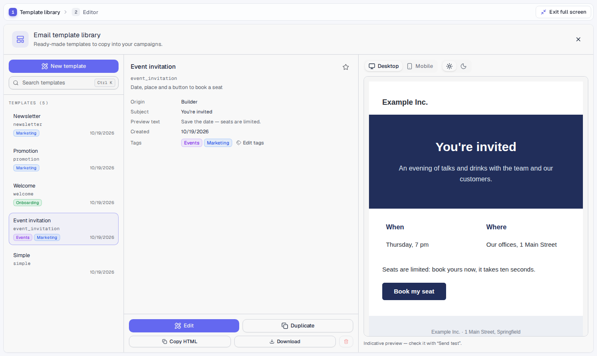

# Editor and library

The package has two blocks. An application can use one of them, the other,
or both:

| Block | Import | What it is |
|---|---|---|
| **A**, the library | `TemplateLibrary` from `best-email-builder/library` | A searchable list of your templates, with up to three colored tags each that also filter it. It shows the selected template's details and its preview (desktop or mobile, light or dark), and five actions: *Edit*, *Duplicate*, *Copy HTML*, *Download* and *Delete*. *Edit* and *New template* only call `onEdit(template)` or `onCreate()`. The library never mounts an editor, and it loads neither the editor's engine nor its MJML compiler. |
| **B**, the editor | `EmailBuilder` from `best-email-builder/builder` | The editor. It opens whatever the host gives it and knows nothing about the library. |
| **A + B** | `EmailStudio` from `best-email-builder` | The two wired together: the library, then the editor, then the library again with the saved template selected. A new template starts from a ready-made base with the editor's *Templates* button. |

Each block has its own entry point, so importing one never pulls in the
other's code. The main entry, `best-email-builder`, exports everything. All
three use the same stylesheet, `best-email-builder/styles.css`.

Both blocks fill their parent, so give the parent a height. They also follow
the parent's width:

- the editor has three columns, then a properties drawer, then the canvas
  alone. The side columns are resized by dragging their border, and fold to a
  narrow rail with the round button on it; the editor remembers both in the
  browser;
- the library has three columns (the list a fifth of the width, never under
  260 px; the template and its preview the same width), then two, then the
  list and the details on two screens.

<p align="center">
  
</p>

## Spacing and controls

Built-in blocks have three spacing layers: margin, border and padding.
The diagram has an empty center. Corner radius has no upper limit; it is in
pixels, and also in percentages on an image or an icon (on a wide button a
percentage makes an oval). Vertical alignment is available on every block.
On a content block, it aligns the containing column. On a layout, it aligns
all its columns. A single column needs extra height from its row for a
vertical position change to be visible.

Images side by side take the height of the row's first image when one of
them gets its file: cropped, not stretched, so what is under them lines up.
The height is in the image's panel; on a phone each image keeps its own
proportions.
Columns in the same desktop row have equal heights. Their content keeps its
chosen vertical alignment. On mobile, stacked columns use their natural height.

The "+" under the selected element opens the blocks: the one picked goes
after it, or at the end of a selected column. The "+" after the last icon
of a social block opens its networks, and the one after a menu's last link
adds a link styled like it. `editor.addItem(choice, id)` does the same from
code; a block declares what its "+" adds in `items`.

The emoji panel mounts nearby rows as you scroll. Search, group shortcuts
and recent emojis use the same grid.

Compile saved MJML with the package's server compiler. It converts additional
box settings into email tables and corrects mixed vertical alignment.
These settings survive an MJML round trip through encoded CSS classes.
An external MJML compiler alone does not apply those additional box settings.

## Desktop and phone

The Desktop / Mobile switch also chooses which styles you edit. In the
Mobile view every style changed applies to phones only and is stored beside
the computer's as `mobile-<attribute>` (`font-size="40px"
mobile-font-size="28px"`); a padding or margin side stands for the whole
group. The compiler builds the email twice and sends the phone's differences
as `!important` rules under the breakpoint, so the canvas, the preview and the
sent email agree. Addresses, pictures, full width and column widths are the
same on every screen. In the Mobile view the panel lists what differs and
puts each back; `editor.clearMobileStyles(id?)` removes them all. Like the
box settings, the phone styles need the package's compiler.

## A + B, nothing to wire

```jsx
import { EmailStudio, createHttpStorage } from 'best-email-builder';

<EmailStudio storage={createHttpStorage()} locale="fr" sender={sender} />
```

| Prop | Description |
|---|---|
| `storage`, `locale`, `messages`, `onNotify` | Passed to both screens. |
| `sender`, `templates` | For the editor: the sender of the bases, and the bases behind its *Templates* button. |
| `ai` | The AI module. Only the editor uses it (see [AI](AI.md)). |
| `onClose` | Shows the library's close button. |
| `libraryProps`, `builderProps` | Extra props for one screen only, such as `libraryProps.deleteDisabled`. |
| `className` | A class on the root element. |

## Block B with your own library

Your library can be a table, a sidebar, a modal or anything else. It decides
what the editor opens, and the editor reports back when it saves or closes:

| Your library wants to… | Pass to `EmailBuilder` |
|---|---|
| open a saved template | `templateId={id}` (the editor loads it from `storage`) |
| start from content it has (a base, an import, a copy) | `initialMjml={mjml}` and, optionally, `initialMeta={{ subject, preheader }}` |
| start from a blank email | neither |
| refresh its list after a save | `onSaved={(template) => …}` (`template.id` is set from the first save on) |
| show itself again | `onClose={() => …}` (the *Back* button) |
| hide the editor's own gallery of bases | `templates={[]}` |

Give the editor a `key` that changes with what it opens. Then switching from
one template to another starts a fresh editor.

```jsx
import { useState } from 'react';
import { EmailBuilder, createHttpStorage } from 'best-email-builder/builder';

const storage = createHttpStorage();

function Emails() {
  const [open, setOpen] = useState(null); // null = my library

  if (!open) {
    return (
      <MyTemplateList                                     // your block A
        onOpen={(id) => setOpen({ key: id, templateId: id })}
        onNew={() => setOpen({ key: `new-${Date.now()}` })}
      />
    );
  }
  return (
    <EmailBuilder
      key={open.key}
      storage={storage}
      locale="fr"
      templateId={open.templateId ?? null}
      initialMjml={open.mjml}
      initialMeta={open.meta}
      onSaved={() => refreshMyList()}
      onClose={() => setOpen(null)}
    />
  );
}
```

Your list can read the same templates with `storage.list()` (summaries,
newest first) or from your own API. The editor only needs the `id`.

## Block A with your own editor

```jsx
import { TemplateLibrary, createHttpStorage } from 'best-email-builder/library';

<TemplateLibrary
  storage={createHttpStorage()}
  locale="fr"
  onEdit={(template) => router.push(`/emails/${template.id}`)}
  onCreate={() => openMyEditor()}             // a new template: your editor offers the bases
  onClose={closeModal}                        // optional: shows a close button
/>
```

The library needs `storage.list()`. The rest depends on what the storage has:

- *Delete* appears when it has `remove()`;
- *Copy HTML* and *Download* appear when `load()` gives the template's `html`,
  as the server does (the HTML compiled at the last save);
- the preview uses `render()`, and otherwise that `html`;
- tags appear when it has `listTags()` and `setTemplateTags()`
  (`createHttpStorage({ tags: true })`, and a `tagStore` on the server; the
  memory storage has them).

### Tags

The *Tags* line of the details opens a dialog. There the user ticks up to
three tags for the template, and creates, renames, recolors or deletes the
workspace's tags. A tag is a name of 24 characters at most, unique case
aside, with one of twelve colors (`TAG_COLORS`) that read well in both themes.
Each change is saved at once. A deleted tag leaves every template. The tags
show in the list before the template's date, and the search finds a
template by its tags too. Under the search, the tags that some template
carries filter the list: one or several (a template with any of them). With
none picked, every template shows; the reset icon next to them unpicks them
all.

| Prop | Default | Description |
|---|---|---|
| `storage` | `createHttpStorage()` | Where the templates are read. |
| `locale`, `messages` | `'en'` | The interface language (see [Languages](LANGUAGES.md)). |
| `onNotify` | built-in notices | `(level, message) => void` to use your own toaster. |
| `title`, `description` | *Email template library* | The header's title and the line below it. |
| `selectedId` | — | The entry selected on opening. |
| `favoritesKey` | `'best-email-builder:favorites'` | The star in the details moves an entry to a *Favorites* section at the top. Favorites are kept in `localStorage` under this key. `null` turns favorites off. |
| `onEdit` | — | `(template) => void`: the user wants to edit a saved template. |
| `onCreate` | — | `() => void`: the user wants a new template. |
| `deleteDisabled` | — | A sentence: *Delete* stays in place, dimmed, and a click shows this sentence instead of deleting. For a public demo. |
| `onClose` | — | Shows a close button. |
| `className` | — | A class on the root element. |

## Editor props

| Prop | Default | Description |
|---|---|---|
| `storage` | `createHttpStorage()` | Where templates and images go (see [Server → Storage contract](SERVER.md#storage-contract)). |
| `templateId` | `null` | The template to open. `null` starts from the starter template, or from a local draft. |
| `locale` | `'en'` | `'en'`, `'fr'`, `'de'`, `'es'`, `'pt'`, `'ru'`, `'zh'`, or any BCP 47 tag used with `messages`. |
| `messages` | — | Extra or overriding translations (`{ 'Save': 'Speichern', … }`). |
| `onNotify` | built-in notices | `(level, message) => void` to use your own toaster. |
| `variables` | `DEFAULT_VARIABLES` | The system merge tags offered in the *Variables* panel beside the canvas: by default only the unsubscribe link, users create the others with **+**. Pass the same list to the server (see [Variables](VARIABLES.md#system-variables)). |
| `sender` | — | `{ name, address, logoUrl, logoWidth }`, used in the starter template's footer. |
| `starterMjml` | — | Replaces the starter template entirely. |
| `templates` | `TEMPLATE_GALLERY` | The ready-made emails behind the *Templates* button (blank, simple, newsletter, welcome, promotion, event invitation). Pass your own `{ id, name, description, tags?, create({ sender, t }), meta?(t) }` entries, or `[]` to hide the gallery. The dialog has a search and the entries' `tags` as filters. |
| `initialMjml`, `initialMeta` | — | Open a NEW template on given MJML and metadata (`{ name, subject, preheader, description }`), for example a template converted from another format. Ignored when `templateId` is set. |
| `testRecipients` | `[]` | Addresses filled in advance in the *Send test* dialog. |
| `onClose` | — | Shows a *Back* button. Called after the user confirms unsaved changes. |
| `onSaved` | — | Called with the saved template. |
| `onDirtyChange` | — | Called when the unsaved state changes. |
| `dirtyCheckRef` | — | A ref that receives a function `() => boolean`, a synchronous check for unsaved changes. |
| `ai` | — | The AI module, `createAi()` from `best-email-builder/ai` (see [AI](AI.md)). Without it, there is no AI button and no AI code in your bundle. |

## Theming

All colors, radii and fonts are CSS custom properties prefixed `--eb-`
(see [`src/styles.css`](../src/styles.css)). Override them on `:root`:

```css
:root {
  --eb-primary: #0f766e;
  --eb-primary-foreground: #fff;
  --eb-font-sans: 'Inter', sans-serif;
}
```

A dark theme applies under a `.dark` ancestor. The stylesheet is built with
Tailwind CSS v4, with an `eb:` prefix and a reset scoped to the builder. It
does not touch the rest of your page, whether or not you use Tailwind
yourself.
